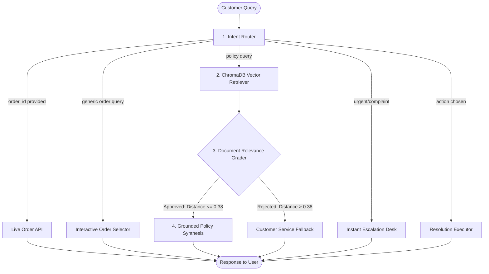

# 📦 Agentic RAG Customer Service Assistant (Amazon Shipping & Orders)

[](https://agentic-rag-app-customer-service.onrender.com/)
[](https://github.com/debanjan-steel/Agentic-RAG-app-Customer-Service)

> **🌐 Live Deployment Link:** [https://agentic-rag-app-customer-service.onrender.com/](https://agentic-rag-app-customer-service.onrender.com/)

---

An autonomous **Agentic RAG** (Retrieval-Augmented Generation) customer support system for Amazon shipping policies and live order tracking. Built with **LangGraph**, **Google Gemini**, **ChromaDB**, and **FastAPI**, featuring both an interactive web application and a terminal CLI.

---

## 🌟 Key Capabilities

1. **🧠 Autonomous Intent Routing (LangGraph)**
   * Dynamically classifies queries into **Order Tracking**, **Policy Search**, **Urgent Escalations**, or **Action Executions**.
   * Routes each query along specialized graph execution paths rather than using a static prompt chain.

2. **🔍 Corrective RAG (CRAG) & Document Grading**
   * Semantically searches pre-embedded Amazon shipping policies in **ChromaDB** using `gemini-embedding-001`.
   * Evaluates vector distance thresholds with an autonomous **Document Grader** node before passing context to the generator.

3. **📦 Live Order State & Interactive Clickable Cards**
   * Simulates real-time order lookups against mock account order memory.
   * When asked generic queries like *"Where is my order?"*, the Web UI generates **interactive, clickable order cards** with live status badges.
   * If a specific order number or product name is mentioned (e.g. *"Where is my Kindle?"* or *"Order 2"*), the agent immediately retrieves that specific shipment.

4. **⚡ Autonomous Escalations & Self-Healing Actions**
   * Handles urgent delivery complaints by offering immediate resolutions:
     * **Option 1:** Complimentary Priority Replacement
     * **Option 2:** Instant Full Refund
     * **Option 3:** Supervisor Phone Callback

5. **🖥️ Dual Interface**
   * **Web UI:** Complete customer service dashboard with live LangGraph reasoning traces and clickable order items.
   * **Terminal CLI:** Interactive REPL and one-shot test runner for evaluation.

---

## 🏗️ Architecture



---

## 📂 Project Structure

```text
├── agentic_rag.py       # Core LangGraph agent, state definition, nodes & routing logic
├── server.py            # FastAPI production backend serving static UI & /api/chat
├── ingest.py            # Chunker and vector embedder for policy markdown docs
├── requirements.txt     # Python dependencies
├── Procfile             # Cloud process runner
├── render.yaml          # 1-click cloud deployment blueprint for Render
├── data/                # Amazon shipping policy knowledge base (.md files)
├── chroma_db/           # Pre-indexed persistent vector database
└── static/              # Web application frontend
    ├── index.html       # Customer Service Hub UI
    ├── style.css        # Amazon design system styles & order cards
    └── app.js           # Frontend client with live reasoning accordions
```

---

## 🚀 Getting Started

### 1. Prerequisites
* **Python 3.13** (recommended)
* A **Google Gemini API Key** ([Get one from Google AI Studio](https://aistudio.google.com/))

### 2. Setup Local Environment

```powershell
# Clone the repository
git clone https://github.com/debanjan-steel/Agentic-RAG-app-Customer-Service.git
cd Agentic-RAG-app-Customer-Service

# Create and activate local virtual environment
python -m venv .venv
.\.venv\Scripts\Activate.ps1

# Install dependencies
pip install -r requirements.txt
```

### 3. Set API Key

Create a `.env` file in the project root:
```env
GEMINI_API_KEY=your_actual_gemini_api_key_here
```

*(Optional: Re-index policy documents)*
```powershell
python ingest.py
```

---

## 💻 Running the Application

### Option A: Web Browser UI (Recommended)
Launch the FastAPI web server:
```powershell
python server.py
```
Open **`http://localhost:8000`** in your browser.

* Ask: *"Where is my order?"* $\rightarrow$ Click any generated card to view details.
* Ask: *"Where is my Kindle?"* $\rightarrow$ Immediately pulls live delivery scan.
* Ask: *"What are the Prime shipping guarantees?"* $\rightarrow$ Runs vector RAG retrieval with source citations.

### Option B: Terminal CLI Mode
Run one-shot test queries directly from your console:
```powershell
# Interactive mode
python agentic_rag.py

# Single query mode
python agentic_rag.py "What should I do if a package is marked delivered but not received?"
```

---

## ☁️ Cloud Deployment (Render / Cloud Run)

This repository includes [`render.yaml`](./render.yaml) and [`Procfile`](./Procfile) for free hosting:

1. Create a free account at [render.com](https://render.com).
2. Click **New +** $\rightarrow$ **Web Service** and connect this GitHub repository.
3. Add an Environment Variable:
   * **Key:** `GEMINI_API_KEY`
   * **Value:** `your-api-key`
4. Click **Deploy Web Service** to get a 24/7 live public URL.

